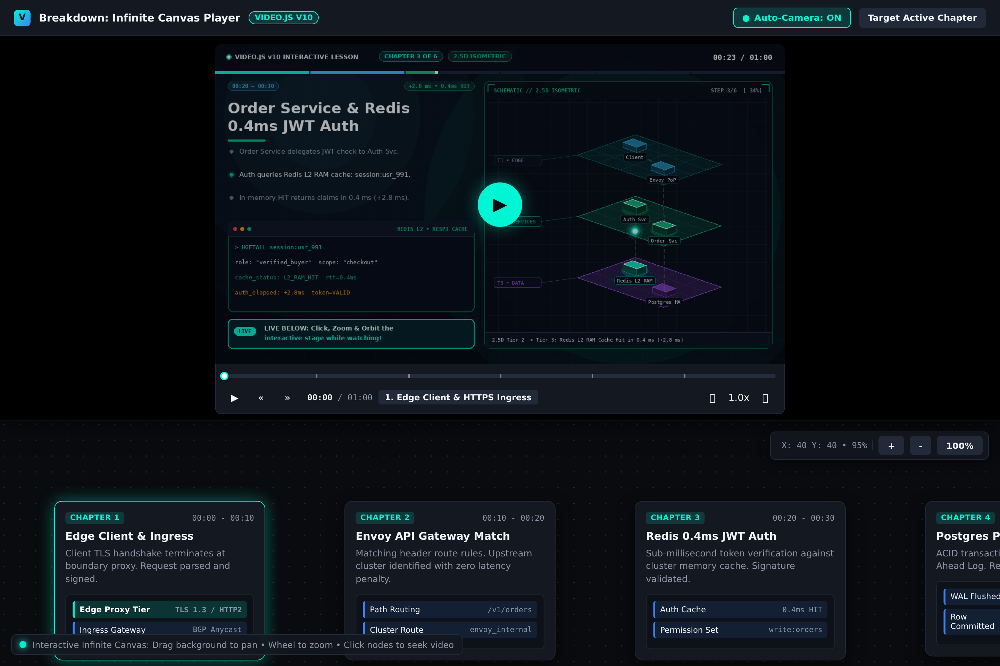

# Breakdown: Video.js v10 Player & Synchronized Infinite Canvas

> **Official Entry for the Video.js v10 Skins Design Challenge**  
> **Live Site URL**: [https://cwwjacobs.github.io/videjs-breakdown-skin/](https://cwwjacobs.github.io/videjs-breakdown-skin/)  
> **Judged by**: Creators of Video.js and Plyr | **Sponsor**: Mux

---

## The Concept

Most video player skins assume passive entertainment: controls float directly over the footage, dimming the picture whenever paused or hovered. But technical walkthroughs, coding lessons, and architecture reviews demand an active posture.

**Breakdown** pairs the **Video.js v10 player** on top with an interactive **Multi-Modal Infinite Canvas directly underneath**:

1. **Grounded Unobscured Video.js v10 Player (Top)**:
   - Dedicated controls card sits cleanly below the video frame.
   - Chapter-segmented seek rail with start ticks, chapter labels, and elapsed/remaining duration.
   - Play/pause, chapter jumping, mute/volume slider, playback speed selection (1x, 1.25x, 1.5x, 2x), and fullscreen.
   - Full keyboard navigation (`K`/`Space` play/pause, `M` mute, `F` fullscreen, `J`/`L` seek, `<`/`>` speed).

2. **Synchronized Infinite Canvas (Underneath)**:
   - Expansive, pannable, and zoomable 60fps infinite coordinate space.
   - Responsive grid background that scales and translates seamlessly with mouse/touch interaction.
   - **Auto-Camera Tracking**: As the video narrator moves through chapters, the camera automatically glides and frames the active chapter node on the canvas.
   - **Click-to-Seek**: Clicking any node or architecture tier on the infinite canvas jumps the video playhead directly to that timestamp.
   - **Spatial 2.5D Nodes**: Each chapter card renders multi-tier architectural models, status beacons, and active packet flows.

---

## Quick Navigation

- **Pan**: Click and drag anywhere on the canvas background.
- **Zoom**: Mouse wheel or trackpad pinch (anchored to cursor).
- **Target**: Click "Target Active Chapter" in the top bar to lock camera back to the video.
- **Seek**: Click any chapter node to jump video playback.

---

## Open Source License

Licensed under the **Apache License, Version 2.0**.
