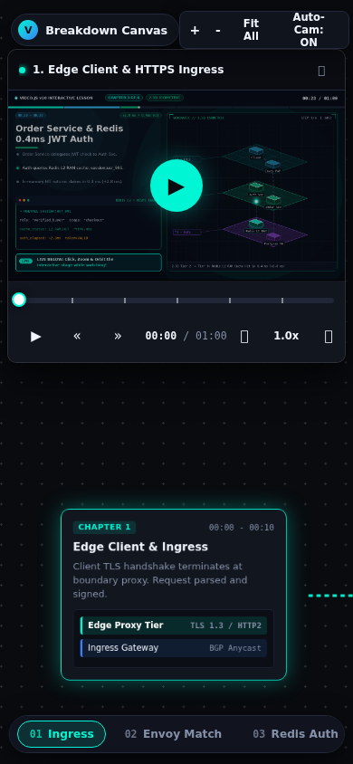

# Breakdown: Video.js v10 Floating Player ON Infinite Canvas

> **Official Entry for the Video.js v10 Skins Design Challenge**  
> **Live Site URL**: [https://cwwjacobs.github.io/videjs-breakdown-skin/](https://cwwjacobs.github.io/videjs-breakdown-skin/)  
> **Judged by**: Creators of Video.js and Plyr | **Sponsor**: Mux

| Desktop View (1440×900) | Mobile View (390×844) |
| :---: | :---: |
|  |  |

---

## The Concept

Most video player skins assume passive entertainment: controls float directly over the footage, dimming the picture whenever paused or hovered. But technical walkthroughs, systems architecture reviews, and coding lessons demand an active, spatial posture. When an engineer pauses a video, the paused frame is precisely what they are studying—obscuring it breaks focus.

**Breakdown** mounts the **Video.js v10 player directly ON an interactive 60fps Infinite Canvas**:

1. **Floating Player Card Mounted ON the Canvas**:
   - The video player floats directly in the viewport above the canvas, keeping footage front and center while the interactive spatial world pans and zooms behind and around it.
   - Grounded control bar below the video frame eliminates overlay dimming.
   - Chapter-segmented seek rail with start ticks, elapsed/remaining time, volume slider/mute, playback speed (0.75x to 2x), and fullscreen.
   - Quick Minimize/Expand toggle (`🗕` / `🗖`) to stash the video into a compact floating thumbnail when focusing purely on the spatial nodes.
   - Full keyboard navigation (`K` / `Space` play/pause, `M` mute, `F` fullscreen, `J` / `L` ±5s seek, `<` / `>` speed adjustment).

2. **Synchronized 2.5D Architecture Nodes**:
   - Expansive 60fps infinite coordinate space with an auto-scaling grid.
   - 6 architectural chapter stages (`01 Ingress Gateway`, `02 TLS Handshake`, `03 Zero-Trust Auth`, `04 Microservice Mesh`, `05 Immutable State`, `06 Return Echo`).
   - Each card features 2.5D isometric tier planes, live status beacons, and SVG animated packet route lines.
   - Auto-Camera Tracking: As the video advances, the canvas smoothly pans to focus on the active stage.
   - Click-to-Seek: Clicking any canvas card instantly navigates the video playhead to that chapter.

3. **Bottom Chapter Navigation Dock & Radar Minimap**:
   - Floating glass pill dock (`01 Ingress` to `06 Return Echo`) with live progress highlights and one-click camera glide + video seek.
   - Real-time radar minimap (bottom-right) showing all nodes, camera viewport bounds, and click-to-teleport.

4. **Engineered for Mobile & Touch Ergonomics**:
   - Full touch gestures: Single-finger smooth pan, two-finger pinch-to-zoom (`touch-action: none`).
   - YouTube-style double-tap on the left/right video halves to jump -5s / +5s with visual ripple feedback.
   - Generous 44px minimum thumb tap targets, elevated 28px seek rail hit zone.
   - Dynamic viewport responsiveness: Auto-adapts layout and gracefully hides secondary minimap on mobile screens (<768px) to maximize touch canvas real estate.
   - `prefers-reduced-motion` compliance: Automatically halts route animations and instant-glides camera for motion sensitivity.

---

## Quick Controls

- **Pan Canvas**: Click & drag anywhere on the canvas (or single-finger swipe on mobile).
- **Zoom Canvas**: Mouse wheel, trackpad pinch, or two-finger touch pinch.
- **Dock Jump**: Tap any chapter pill in the bottom dock.
- **Double Tap Video**: Double tap left half for -5s, right half for +5s (mobile touch).
- **Minimize Video**: Click `🗕` in the player header to shrink the player.
- **Keyboard**: `Space`/`K` (Play/Pause), `M` (Mute), `F` (Fullscreen), `J`/`L` (±5s Seek), `0-9` (Seek % ratio).

---

## Open Source License

Licensed under the **Apache License, Version 2.0**.
